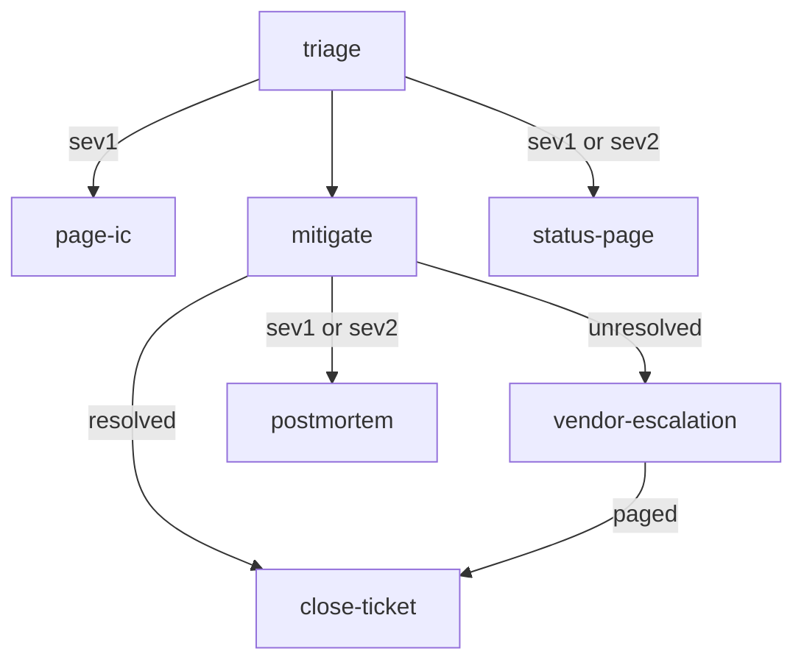

# Incident

Goal of the flow: restore the service, or escalate it. The memory commands are in `examples/incident`. The agent is `oncall`. `seed.sh` writes the severity guide. Each incident has a case scope such as `case-inc-311`, and runbooks go in `org`.



| Flow step | Memory command | Why |
| --- | --- | --- |
| `triage` | `recall --about severity` | The severity guide every incident starts from. |
| `mitigate` | `recall --about checkout --about runbook` | A fix that worked before. `--fresh` when an old runbook is risky. |
| `mitigate`, failed | `remember` in the case scope | A note for the retry, not for later incidents. |
| `postmortem` | `remember` or `correct` in `org` | What worked, with the incident as the source. |

## Sev1, resolved

`run-sev1-resolved.sh`. `triage` recalls the severity guide. `mitigate` recalls no runbook. Draining the pool and rolling back works, and `postmortem` remembers `checkout-runbook` in `org` with `INC-311` and `PM-14` in `--because`. Ten days later the next outage recalls it with `use`.

## Sev2, unresolved

`run-sev2-unresolved.sh`. The runbook comes back with `use`, but the rollback does not fix search, and `vendor-escalation` pages the vendor. The agent corrects `checkout-runbook` to add the vendor page and adds `search` to its subjects, so a search incident finds it:

```json
{"at":"2026-11-10T21:00:00Z","generation":2,"key":"checkout-runbook","scope":"org"}
```

## Sev3

`run-sev3.sh`. One chart is stale. The dashboard runbook is 45 days old, and the agent will not trust anything older than 30 days:

```json
{"action":"stale","fresh":"30d","memories":[{"about":["dashboards","runbook"],"agent":"oncall","at":"2026-11-10T18:00:00Z","because":"INC-288: refreshing the cache fixed the revenue chart.","claim":"A stale chart is fixed by refreshing the chart cache from the dashboards admin page.","generation":1,"key":"chart-refresh","scope":"org"}],"stale":["chart-refresh"]}
```

The claim is still returned. The agent checks it. If the fix changed, it corrects the claim. If it still holds, it runs `correct` with the same claim and a `--because` naming the check, which writes a new generation with a new `at`, and the next `--fresh 30d` recall returns `use`.

## Retry

`run-retry.sh`. The first `mitigate` attempt fails because the deploy lock is held, and the agent notes that in `case-inc-313`. The retry works, so the note is wrong. The agent forgets it. Forgetting it a second time writes nothing:

```json
{"forgotten":false,"key":"rollback-blocked","scope":"case-inc-313"}
```

`close-ticket` recalls `none` for the case.

## Replan

`run-replan.sh`. `mitigate` fails twice and the plan is revised to bring the vendor in. The agent widens its recall to every checkout memory. Six keys match and the limit is five, so it gets `narrow`: the keys and their subjects, without the claims. It picks `checkout-vendor` next, by key or with `--about vendor`.
