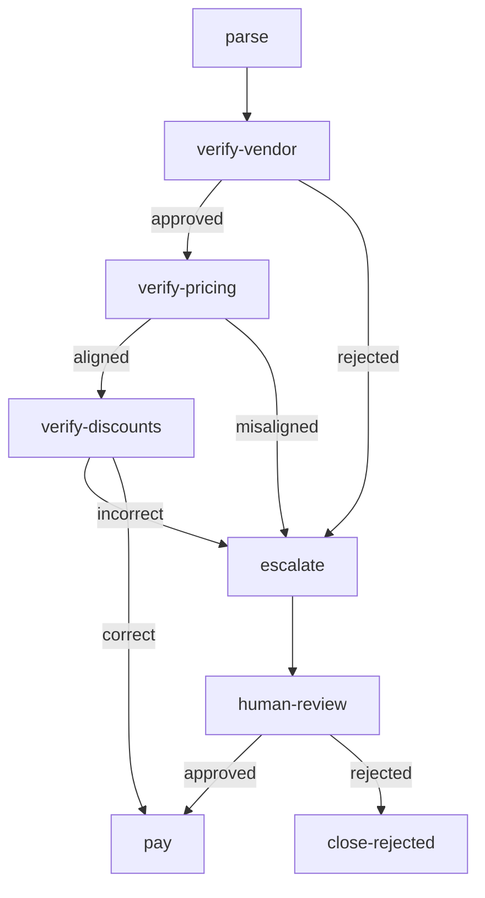

# Invoice

Goal of the flow: pay INV-1042, or hand it to a person. The memory commands are in `examples/invoice`. Each run script has the name of a relate-flow script and shows what the `invoices` agent recalls and remembers at each step of that run. `seed.sh` writes the org-wide review rule. The case scope is `case-inv-1042`.



| Flow step | Memory command | Why |
| --- | --- | --- |
| `verify-vendor` | `recall --about northwind --about vendor-list` | The approved list may already be known. |
| `verify-pricing` | `recall --about northwind --about nw-2024` | The agreement price may already be known. |
| `verify-discounts` | `recall --about northwind --about discounts` | The discount rule and how shortfalls are handled. |
| `human-review` | `remember` or `correct` in `org` | A ruling that applies to later invoices. |
| `close-rejected` | `prune --scope case-inv-1042` | Nothing in the case scope outlives the case. |

## Discount missing, then approved

`run-discount-missing.sh`. `verify-discounts` recalls `none`. The agent reads NW-2024 and remembers `widget-price` in `org`. After `human-review` approves $9,000, it remembers `shortfall-handling`, the rule rather than the amount. A week later, INV-1077 recalls both with `--scope case-inv-1077 --scope org` and gets `use` with two memories.

## Discount missing, then rejected

`run-discount-rejected.sh`. The price goes in `org` as before. The rejection is about INV-1042 only, so `review-outcome` goes in `case-inv-1042`. `close-rejected` recalls it, prunes the scope, and recalls again:

```json
{"about":[],"action":"none","keys":["review-outcome"],"scopes":["case-inv-1042"]}
```

## Discount already correct

`run-discount-correct.sh`. An earlier case remembered the price. `verify-pricing` recalls `use` and does not open the agreement. At `verify-discounts` the agent remembers the same fact again, and gets the stored generation back unchanged, with its original `at`. A retried write is safe.

## Vendor rejected

`run-vendor-rejected.sh`. `verify-vendor` remembers that Northwind is not on the approved list. The person approves payment anyway. The agent, as `human`, corrects `vendor-status` to say a person approves each Northwind invoice. `log vendor-status --json` shows generation 2 live, by `human`, and generation 1 retired. Three days later the next invoice recalls generation 2.

## Missing agreement

`run-missing-agreement.sh`. NW-2024 is not on file, so a phone quote goes in `case-inv-1042`. When the agreement arrives, writing it under the same key and scope is refused:

```json
{"error":{"code":"key_taken","fix":"relate-semantic correct widget-price --scope case-inv-1042 --claim TEXT --because TEXT --about discounts --about northwind --about nw-2024","message":"widget-price is already live in case-inv-1042: \"For INV-1042 only, finance quoted $100 per widget by phone while NW-2024 was mis…\"","retryable":false}}
```

The agreement price belongs in `org`, so the agent writes it there. The key is now live in two scopes, and a recall with no `--scope` returns `conflict`. Its `fix` names both scopes, and the agent orders them so the one that should win comes first.
