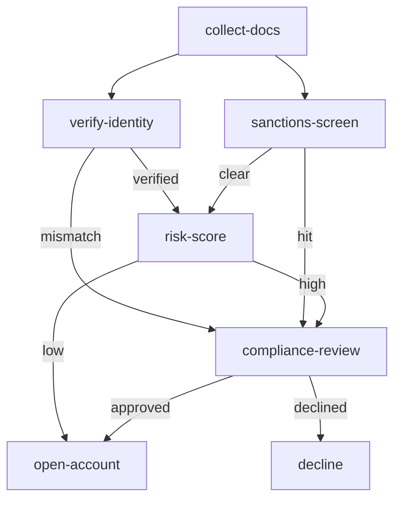

# Onboarding

Goal of the flow: open the account, or decline the application. The memory commands are in `examples/onboarding`. The agents are `kyc` and `compliance`. `seed.sh` writes the accepted identity documents. Each application has a case scope such as `case-app-4`, and rulings that apply to later applicants go in `org`.



| Flow step | Memory command | Why |
| --- | --- | --- |
| `verify-identity` | `recall --about identity` or `--about name-mismatch` | Accepted documents, and past rulings on name mismatches. |
| `sanctions-screen` | `recall --about ENTITY` | A known hit on the same entity. |
| `risk-score` | `recall --about risk --about threshold` | The threshold analysts use. |
| `compliance-review` | `remember` in `org` as `compliance` | A ruling later applicants are judged by. |

## Clear

`run-clear.sh`. `risk-score` recalls `none` and remembers `low-risk-threshold` in `org`. The next day APP-6 recalls it with `use`.

## Mismatch, approved

`run-mismatch-approved.sh`. APP-2's name differs from the document by transliteration. Compliance approves, and the ruling goes in `org` with `--agent compliance`. Two days later APP-7 has the same kind of mismatch and recalls the ruling, with `"agent":"compliance"` showing who made it.

## Hit, declined

`run-hit-declined.sh`. The hit is about Orion Trading LLC, not about APP-3, so `sanctioned-entity` goes in `org` with the entity as a subject. Five days later APP-8 lists Orion Trading LLC as an owner, and `sanctions-screen` recalls it with `--about orion-trading`.

## Blocked

`run-blocked.sh`. The passport image for APP-4 can't be read. The agent first pastes the OCR dump as the claim and is refused:

```json
{"error":{"code":"too_long","errors":[{"code":"too_long","field":"claim","fix":"write only the fact in --claim, and put the source in --because","message":"--claim is 815 characters and the limit is 600"}],"fix":"relate-semantic remember app-4-document --claim TEXT --about passport-scan --scope case-app-4 --because TEXT","message":"--claim is 815 characters and the limit is 600","retryable":false}}
```

It writes one sentence instead, but with the subject `Passport Scan`, and gets `bad_slug`. The `fix` already has `--about passport-scan`, so the agent replaces `TEXT` and runs it. After the revision, `verify-identity` recalls the note from the case scope.

## Reopened done-when

`run-reopen-donewhen.sh`. relate-flow reopens `collect-docs` to require a proof of address. Compliance changes what counts, and corrects `address-proof` with new subjects, `proof-of-address` and `documents`. A recall by the old subject `address` now returns `none`, so the old wording cannot come back through a stale subject. A recall by `proof-of-address` returns generation 2.
